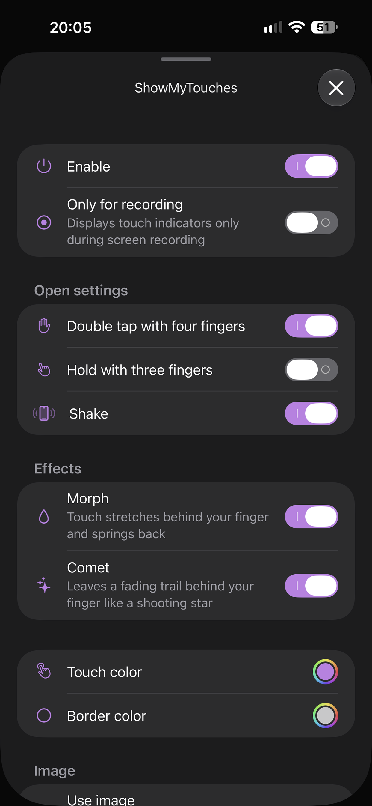
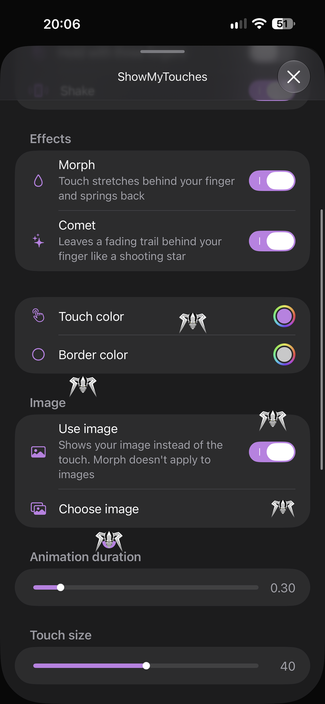
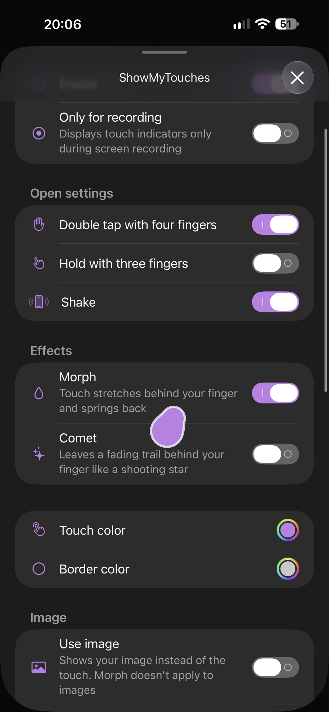
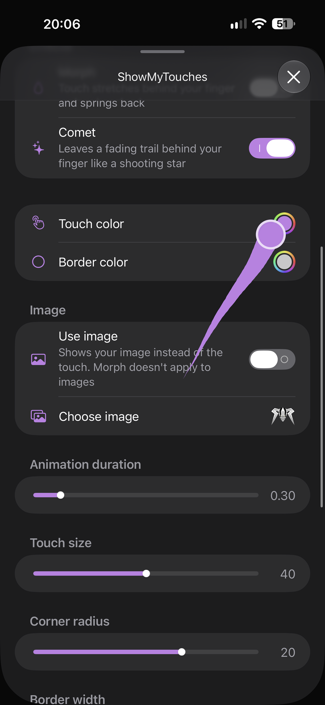

# ShowMyTouches
The tweak that displays visual indicators for touch interactions on the screen.

## Screenshots

| Settings | Multitouch with a custom image | Morph | Comet |
|---|---|---|---|
|  |  |  |  |

## ShowMyTouches currently supports:
- Rootful, Rootless and Roothide jailbreaks
- Displaying interactions always or during screen recording only
- Multitouch
- Indicators that never get in the way: taps pass straight through, so fast typing on the keyboard works as usual
- Effects, which can be combined:
  - **Morph**: the touch flows behind your finger like a liquid drop and gathers back when it stops
  - **Comet**: a fading trail behind your finger, like a shooting star
- Idle breathing: a resting touch gently grows and shrinks
- Custom image instead of the touch, picked from Photos and resized to fit 180×180 px with its proportions kept
- Color picker for the touch and its border
- Display configuration: animation duration, touch size, corner radius and border width
- Localization: English, Russian, Arabic, Turkish, Vietnamese, Simplified and Traditional Chinese

<br>

**ShowMyTouches preferences can be found in the iOS Settings, does not require respring**

## Sideloading
ShowMyTouches can also be injected into an IPA to show touches inside a single app without a jailbreak. Build it with the `SIDELOADING` flag:

```bash
make clean package SIDELOADING=1
```

In this build the settings live inside the app and open as a sheet on any screen. There are three ways to open them, each can be turned on or off in the **Open settings** section:
- Double tap with four fingers (on by default)
- Hold with three fingers (off by default)
- Shake (on by default)

At least one of them always stays on, and they keep working even when the tweak itself is disabled, so the settings are always reachable.

## Support
If you like the tweak, you can support me on [Boosty](https://boosty.to/dayanch96) or [Buy me a coffee](https://buymeacoffee.com/dayanch96) ❤️

## Credits
Special thanks to [**Artem Kasper** (@Kesa2773)](https://github.com/Kesa2773) for the inspiration and main hook code
